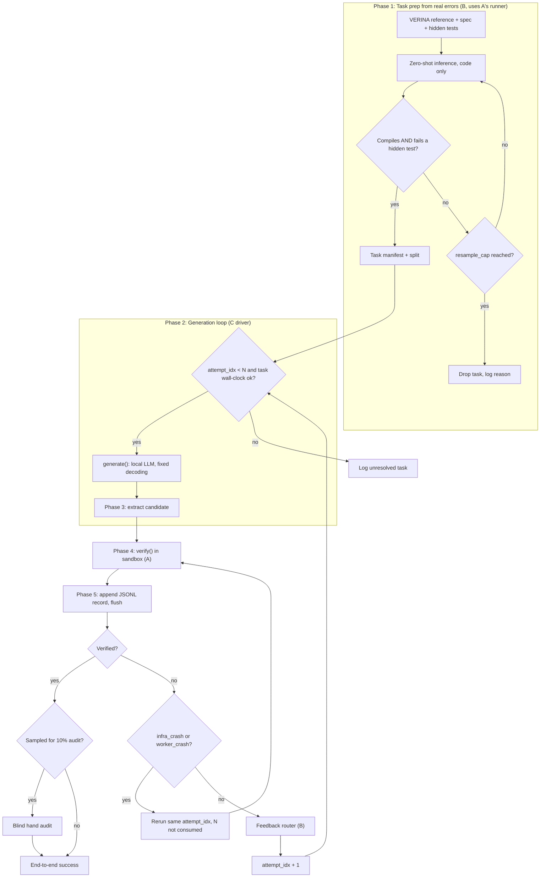

# ARCHITECTURE.md — Shape the Code, Not the Proof

Revision 3 · 2026-11-02 · Companion to `AutoSE_Project_Plan_v2.docx`
Team: Agents of Ultron (CS6.403 AutoSE)

Engineering view of the study. The plan says *what* we test and *who* owns what; these files say *how the pieces fit and what every limit is*. If the two disagree, the plan's frozen rules (plan section 2) win and these files must be fixed.

## Where to look

| File | Owner | Contents |
|---|---|---|
| this file | all | overview, flow, repo layout |
| [docs/config.md](docs/config.md) | all | `params.yaml`, `models.yaml`, master limits table, failure taxonomy |
| [docs/interfaces.md](docs/interfaces.md) | all | task manifest, attempt record, `generate()` and `verify()` |
| [docs/verifier.md](docs/verifier.md) | **A** | Phase 4: pre-filter, sandbox, worker, tactic router, tests, caching |
| [docs/tasks-and-models.md](docs/tasks-and-models.md) | **B** | Phase 1 harvest, Phase 3 extraction, feedback router |
| [docs/driver-and-analysis.md](docs/driver-and-analysis.md) | **C** | Phase 2 loop, logging, audit, cross-evaluation, power, energy |
| [docs/checks.md](docs/checks.md) | all | acceptance checks, go/no-go, assumptions and open issues |

## Changes in revision 3

| # | Change | Where |
|---|---|---|
| 1 | **Cross-evaluation.** B's compiling-but-unproved code re-run through C's pipeline. Secondary analysis, not a condition. | [driver-and-analysis](docs/driver-and-analysis.md#cross-evaluation-bs-code-through-cs-pipeline) |
| 2 | **No tactic ban in B.** `grind`/`aesop` stay legal; log `proof_tactic_used` instead. | [interfaces](docs/interfaces.md), [driver-and-analysis](docs/driver-and-analysis.md) |
| 3 | **Power calculation before the freeze.** Simulated on `p01`/`p10`. Sets the task count. | [driver-and-analysis](docs/driver-and-analysis.md#statistical-power-before-the-week-2-freeze) |
| 4 | **Persistent Lean worker.** `import Mathlib` paid once per batch, not per process. | [verifier](docs/verifier.md#sandbox-and-the-persistent-lean-worker), [config](docs/config.md) |

Rejected: regex ban on `grind`/`aesop` in B. Makes B a strawman, the automation line is incoherent (C's own light tier is `simp`/`omega`/`decide`), and it is unenforceable (`by first | grind | aesop`, `<;> grind`). Change 2 replaces it.

---

## 1. System overview

In condition C the model never writes a proof. It repairs the implementation, and a fixed, pre-registered tactic pipeline (simp, omega, decide, grind, aesop and combinations) proves the unchanged contract. Condition B — model writes code and proof, with Lean error feedback — is the fair control. **B versus C at equal attempts is the paper.**

### 1.1 End-to-end flow



### 1.2 Components and owners

| Component | Owner | Runs | Input | Output |
|---|---|---|---|---|
| Harvester (Phase 1) | B | model + A's compile/test runner | VERINA task | task manifest |
| Model server | B | llama.cpp / Ollama / vLLM | prompt | text |
| `generate()` incl. feedback router | B | Python | task, condition, history, seed | next candidate |
| Driver (loop, N budget, reruns, energy) | C | Python | manifests | attempt records |
| `verify()` (pre-filter, worker, router, tests) | A | Lean + Python | task, candidate | typed result |
| Goal analyzer / hint extractor | A | Python (no LLM) | first unsolved goal | route + hint |
| Logger and audit sampler | C | Python | verify + generate outputs | JSONL, audit list |
| Analysis | C | Python | JSONL | tables, figures |

Only two things cross between Parts: the **task manifest** and the **attempt record**, plus two calls, `generate()` and `verify()`. See [docs/interfaces.md](docs/interfaces.md).

---

## 2. Repository layout

```
repo/
  prereg/                      # frozen at the Week 2 gate, hashed
    params.yaml                # every limit, timeout, N, cap
    models.yaml                # model registry
    tactics.lean.list          # ordered tactic tiers + hash
    hint_templates.yaml
    prompts/{A,B,C,C-plain}.txt
    interfaces.md  definitions.md
  common/                      # shared by all three Parts
    config.py                  # loads params.yaml / models.yaml, verifies hashes
    schema.py                  # manifest + attempt-record validators
    hashing.py                 # sha256 helpers, candidate hash
  verifier/                    # Member A
    sandbox.py                 # worker pool, limits, kill, failure classification
    prefilter.py               # spec-gaming pre-check
    goal_analyzer.py           # route + hint
    tactics.py                 # light/heavy tiers
    tests_runner.py            # hidden tests
    verify.py                  # verify() entry point + cache
  tasks/                       # Member B
    harvest.py                 # zero-shot error harvesting (Phase 1)
    mutate.py                  # fallback only
    manifests/{pilot,main,heldout}/*.json
  models/                      # Member B
    serve.py  generate.py  router.py  extract.py
  driver/                      # Member C
    run.py                     # loop over task, condition, model, seed, attempt
    energy.py                  # codecarbon wrapper
    audit.py                   # 10% sampler
  analysis/                    # Member C
    crosseval.py               # replay B's code through C's pipeline
    power.py                   # McNemar power simulation
  logs/                        # attempts.jsonl, lean logs, prompts (append only)
  ARCHITECTURE.md  docs/  README.md
```
