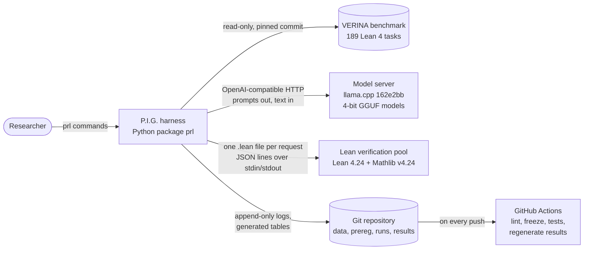
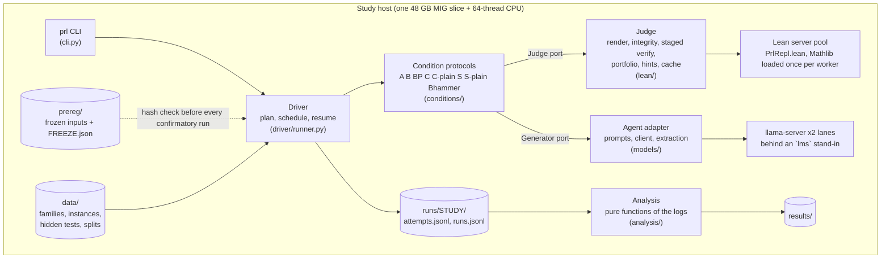
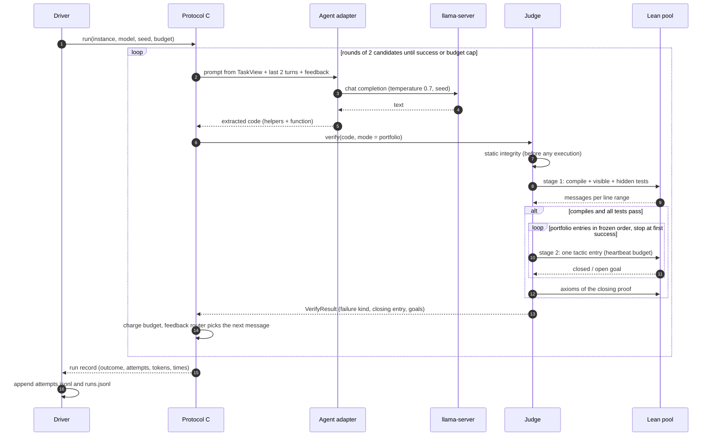
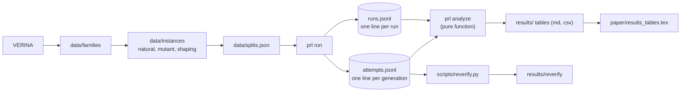

# Design and Architecture: how P.I.G. was designed, and why

**Audience:** a reader who wants the design reasoning rather than the code. It tells one story: what the system
had to guarantee, the architecture that delivers it, the decisions behind it with their alternatives, how the
design changed under evidence, and what we would design differently.
**Details elsewhere:** components and protocols in [`high_level_design.md`](high_level_design.md), schemas and
algorithms in [`low_level_design.md`](low_level_design.md), one record per decision in [`adr/`](adr/README.md),
requirements in [`requirements.md`](requirements.md) and their status in [`requirements_check.md`](requirements_check.md),
every change after the freeze in [`../prereg/deviations.md`](../prereg/deviations.md).

---

## 1. The problem the architecture has to solve

The scientific question is simple: do small models produce more *verified* repairs when they repair only code and a
fixed Lean automation portfolio writes the proof (condition C), than when they write proofs (B), or write proofs
after the same automation has been tried (BP)? The engineering problem is that the answer is only worth anything
if four things hold at once, and each pulls the design in a different direction:

| # | Driver | Why it is hard | What a failure would look like |
|---|---|---|---|
| D1 | **The judge cannot be fooled** | Small models produce `sorry`, new axioms, edited specifications, hard-coded tests, and code that loops forever. All of it arrives as text we must execute | a "verified repair" that is not one; every number in the paper is then wrong |
| D2 | **The comparison is fair** | Conditions differ in who writes the proof and what feedback is shown. Anything else that differs (budget, information, time, prompt content) is a confound | C "wins" because it got more time or saw more information |
| D3 | **The study is reproducible and was not tuned on its answer** | ~12,000 runs, two days of GPU time, many knobs (prompts, tactics, caps) that could be adjusted after seeing results | results that cannot be regenerated, or a protocol fitted to the data |
| D4 | **It runs on small hardware in days** | One Lean check of a Mathlib file costs 25–40 s cold; the study needs hundreds of thousands | the study does not finish, or is cut down until it has no power |

Two secondary drivers: **mechanism visibility** (the design must log what is needed to tell *shaping* code for
automation from *reverting* the bug) and **failure isolation** (an infrastructure fault must never be counted
against a model).

### Quality-attribute scenarios, and how each was checked

| Attribute | Scenario | Response the design guarantees | Evidence |
|---|---|---|---|
| Integrity (D1) | A candidate contains `sorry`, `native_decide`, a new axiom, or a weakened postcondition | rejected before or by Lean; never counted | 24 Lean integration tests, zero false successes (`tests/test_lean_integrity.py`) |
| Integrity (D1) | A reported success is challenged after the study | it is re-checked from its logged code and proof | all 1,858 logged successes re-verify on a second machine and OS ([`results/reverify/`](../results/reverify/summary.md)) |
| Fairness (D2) | Two conditions run on the same instance and seed | identical start code, turn-0 information, decoding and budget | `test_turn0_information_equal_across_conditions`, `test_budget_class` |
| Fairness (D2) | A prompt is built | it cannot contain the reference implementation or hidden tests | `TaskView` projection; `test_prompt_never_leaks_reference_or_hidden` |
| Reproducibility (D3) | Someone edits a prompt, tactic or budget after the freeze | confirmatory runs refuse to start | SHA-256 freeze; `test_cli_refuses_confirmatory_run_on_modified_prereg` |
| Reproducibility (D3) | Someone wants to check a number in `results/` | it regenerates byte for byte from the committed logs | CI job on every push ([`.github/workflows/ci.yml`](../.github/workflows/ci.yml)) |
| Performance (D4) | One verification request | ~0.6 s instead of 25–40 s | verification server ([ADR 0010](adr/0010-verification-server.md)); 12,249 runs in 14.7 h |
| Failure isolation | A Lean worker crashes or runs out of memory | the same candidate is re-verified; the model's budget is not charged | 1 infrastructure failure in 12,249 runs, resumed |
| Robustness | A candidate does not terminate | heartbeats decide proofs; a wall guard kills the process tree | `test_hung_lean_process_tree_is_killed_within_wall_guard` |

---

## 2. Architecture at a glance

### 2.1 Context (C4 level 1)



The harness is the only component that talks to both the model and Lean. The model never sees the file system,
the reference implementation or the hidden tests; Lean never sees the model.

### 2.2 Containers (C4 level 2)



### 2.3 Components and the layering rule

| Layer | Package | Responsibility |
|---|---|---|
| Interface | `prl.cli` | one command per pipeline step (`tasks`, `hidden`, `bugs`, `splits`, `run`, `freeze`, `power`, `crosseval`, `analyze`, `audit`, `probe`) |
| Orchestration | `prl.driver` | expand the plan (split × condition × model × seed × instance), deterministic order, thread pool, resume |
| Protocols | `prl.conditions` | the eight condition loops, budget accounting, feedback router |
| Agent | `prl.models` | `TaskView`, prompt templates, OpenAI-compatible client, output extraction |
| Judge | `prl.lean` | file rendering, static integrity, Lean runner and pool, portfolio, axioms, hints, cache |
| Benchmark | `prl.tasks`, `prl.testgen`, `prl.mutate`, `prl.natural` | VERINA parsing and regions, hidden tests, mutants, natural bugs, splits |
| Science | `prl.analysis` | outcome labels, statistics, power simulation, mechanism, code shapes, reports, audit sample |
| Foundation | `prl.config`, `prl.prereg`, `prl.energy` | paths, frozen configuration, freeze hashing |

**Rule:** dependencies point downward, and the Agent and Judge layers never import each other. They meet only in
`prl.conditions`, through two small typed interfaces (`Generator.complete` and `JudgeLike.verify` in
[`prl/conditions/protocols.py`](../prl/conditions/protocols.py)). `test_package_layering` fails the build if
either package imports the other. This one rule is what makes the protocols testable with fake models and fake
judges (`tests/test_protocols_driver.py`) and what keeps a model from ever influencing how it is judged.

Size: about 5,400 lines of Python in `prl/`, 1,050 lines of tests, and a 52-line Lean verification server.

---

## 3. Runtime views

### 3.1 One run of condition C



**B** differs in exactly three places: the model returns code *and* a proof, stage 1 also checks that proof, and
there is no stage 2. **BP** runs stage 2 first and falls back to the model's proof. Everything else (prompt
skeleton, turn-0 information, budget, decoding, history length) is shared. The whole difference between the
conditions is one table, `MODE` in `protocols.py`, plus the feedback router.

### 3.2 The verification pipeline is ordered by cost and by trust

```
candidate text
  -> static scan            (cheap, fail-closed; a malicious candidate never reaches Lean)
  -> render into the locked template, check locked-region hash
  -> stage 1: compile + all tests in one Lean request   (most candidates stop here)
  -> stage 2: portfolio entries one by one, cheapest tier first, early stop
  -> #print axioms ⊆ {propext, Classical.choice, Quot.sound}
  -> success = compile ∧ tests ∧ proof by the allowed source ∧ integrity
```

Ordering by cost is what made the study affordable: the expensive tactics only run on code that already passes
every test. Ordering by trust is what makes it safe: nothing the model wrote is executed until it has passed the
static scan.

### 3.3 Data lineage: every number is a projection of an append-only log



Logs are written one atomic line at a time and never rewritten. A run is complete if and only if its line exists
in `runs.jsonl`, so resuming after a crash is "skip what is there". Analysis reads the logs and writes `results/`,
nothing else, so CI can regenerate `results/` and compare it with the committed files.

---

## 4. Deployment: as designed and as built

| | As designed (2 Nov) | As built (5–6 Nov) | Why it changed |
|---|---|---|---|
| Machine | Windows 11 laptop, RTX 5060 8 GB | Ubuntu 24.04 server, one MIG slice 2g.48gb of an RTX PRO 6000 Blackwell, Threadripper PRO 7975WX | every step had to run in one environment; the laptop could not hold the study in time (R-1, R-3) |
| Model server | LM Studio | llama.cpp `162e2bb` `llama-server`, behind an `lms` stand-in script | the server runs llama.cpp; the stand-in answers the same `lms` commands, so the client and driver code stayed unchanged |
| Concurrency | 4 run workers | 2 lanes × 12 concurrent requests, 6 Lean workers | measured saturation point of the slice (R-6, R-7) |
| Lean memory cap | Windows Job Object, 4 GB per worker | none on Linux | the API is Windows-only (R-10) |
| Energy | NVML counter per (model, condition) block | estimated after the study by calibration | the meter read the wrong physical GPU (D-1, D-4) |

The move between the two columns took a few hours on 5 Nov and changed **no code in the judge, protocols or analysis**.
That is the payoff of the ports in §2.3: the model server is behind an OpenAI-compatible HTTP port, so swapping
LM Studio for llama.cpp was an adapter (`scripts/irel/bin/lms`), not a redesign.

---

## 5. Key design decisions, with alternatives and trade-offs

Each row links to its record. The "cost" column is what we gave up.

| Decision | Alternatives considered | Chosen because | Cost accepted | ADR |
|---|---|---|---|---|
| The model writes code only; a **frozen** tactic portfolio writes the proof | model writes proof (B); learned tactic selection | removes proof writing from the model without adding a tunable component | automation can only prove what its tactics reach (no recursion) | [0001](adr/0001-code-only-repair-with-frozen-portfolio.md) |
| Controls **BP** (automation first, then model proof) and **S** (re-shape correct code) | compare only against B | pre-empts the two obvious objections: "B is a strawman" and "C just reverts the bug" | two extra conditions of GPU time | [0002](adr/0002-control-conditions.md) |
| Task **family** is the statistical unit; family-level splits; held-out run once | pool runs; random split by instance | instances of one family are not independent; held-out guards against fitting | fewer units, so less power (C vs BP: 0.08 for 4B) | [0003](adr/0003-verina-benchmark-and-splits.md), [0012](adr/0012-statistical-analysis.md) |
| Natural bugs from other models, mutants as fallback, rule fixed before any data | mutants only | realism; the rule could not be bent after seeing the count (33 < 60, so the fallback applied) | natural pool is thin | [0004](adr/0004-bug-sources-and-pool-rule.md) |
| **Hidden** generated tests with Lean-proved preconditions | trust the proof alone; Python-side filters | a proof certifies only its specification; hidden tests catch weak specs | five families got no hidden tests (D-5) | [0005](adr/0005-hidden-tests.md) |
| Two **heartbeat** tiers, early stop, same for every portfolio user | wall-clock limits; a goal classifier choosing tactics | heartbeats are deterministic; a classifier is an unregistered degree of freedom | some proofs need more than 200k heartbeats | [0006](adr/0006-two-tier-portfolio.md) |
| **Static** integrity scan before Lean; locked regions re-emitted by the harness | trust Lean alone; ask the model for the body only | fail-closed: hostile text is never executed; whole-function output suits small models | some honest submissions are rejected as malformed | [0007](adr/0007-integrity-checks.md) |
| One **matched budget** (8 generations, 48k tokens, 600 s) for all conditions | per-condition budgets | the only fair comparison; the 240 s cap was raised to 600 s when the pilot showed it was not condition-neutral | slower runs | [0008](adr/0008-run-budget.md) |
| Own **verification server** with full Mathlib, CLI fallback with parity test | `lean` per file; community REPL; reduced imports | ~40× faster, no third-party code, same verdicts | ~2.5 GB RAM per worker | [0010](adr/0010-verification-server.md) |
| **Pre-registration**: hash every input, refuse to run on mismatch, log every deviation | informal protocol | makes "we did not tune on the result" checkable by a machine | every later change must be disclosed (D-1 to D-7) | [0011](adr/0011-pre-registration.md) |
| Shaping vs reverting defined from **logged** quantities (reference provable? distance to reference) | judge mechanism by hand | mechanism is visible by construction, no manual labels | thresholds (revert distance 0.15) are a choice | [0013](adr/0013-shaping-vs-reverting.md) |
| Results **re-checked by machines** (CI regeneration, full Lean re-verification) | trust the logs | turns "the logs say so" into "anyone can re-run it" | 1.3 h of Lean time, CI minutes | [0016](adr/0016-independent-rechecking.md) |

---

## 6. Patterns we used, and the attribute each one buys

| Pattern | Where | Attribute |
|---|---|---|
| **Ports and adapters** | `Generator` / `JudgeLike` protocols; OpenAI-compatible client; `lms` stand-in | portability (laptop to server without touching the core), testability with fakes |
| **Information hiding by projection** | `TaskView` is the only input to a prompt | fairness and no leakage, by construction rather than by review |
| **Table-driven strategy** | `MODE`, `ROUND_CONDITIONS`, `SEQUENTIAL`; the feedback router (failure kind × condition) | conditions differ only where the design says; adding a condition is a table row and a prompt |
| **Fail-closed pipeline ordered by cost** | static scan, stage 1, stage 2, axioms | integrity and cost |
| **Object pool** | Lean workers, each holding Mathlib in memory | performance |
| **Content-addressed cache** | SHA-256 of the rendered file, portfolio and mode | identical candidates are verified once, across conditions and seeds |
| **Append-only event log + pure projections** | `attempts.jsonl`, `runs.jsonl` → `prl analyze` | resume, idempotent analysis, byte-identical regeneration in CI |
| **Guard on frozen configuration** | `FREEZE.json` digest checked by the driver | reproducibility, no post-hoc tuning |
| **Retry without charge, confirm before blaming** | infrastructure failures retried; timeouts confirmed in a fresh worker | failure isolation: the model is never penalised for our faults |

---

## 7. How the design evolved, and what forced each change

| Date (2026) | Version | What changed | Evidence that forced it |
|---|---|---|---|
| 16 Oct | Proposal | Lean 4 as a gatekeeper for model-written patches | — |
| 26–29 Oct | Refined proposal "Prove Less, Repair Better" and project plan | code-only repair for small models against proof writing, on VERINA | — |
| 2 Nov | v2: design docs, harness, tests | BP and S added; family as unit; hidden tests; own Lean server | external reviews of the proposal ("B is a strawman", "C just reverts"); 25–40 s per cold Lean check |
| 3 Nov | v2.1: review additions | B→C cross-evaluation, B_noauto, Bhammer (exploratory), power simulation required before freeze | team review; need to know whether C vs BP could be detected at all |
| 4 Nov | Pre-pilot | exclusion list of five known-bad tasks; probe data; first pilot | tests that contradict their own specification |
| 5 Nov | Team decisions (ADRs) | time cap 240 s → 600 s; Bhammer runs unconditionally; 4-bit kept; no new exclusions | the 240 s cap stopped 11.9% of 4B B runs and 0% of C runs: not condition-neutral |
| 5 Nov | Second freeze (`3f2744e1`) | restart on one GPU slice for every step; the first freeze is superseded before any confirmatory result | one environment for dataset, pilot and study (R-1 to R-10) |
| 5–6 Nov | Study | 12,249 runs in 14.7 h, two lanes | — |
| 6 Nov | Post-freeze | energy meter withdrawn and replaced by calibration (D-1, D-4); audit sampler fixed (D-2) | meter read physical GPU 0 |
| 7 Nov | Repository clean-up | decisions rewritten as 15 Nygard ADRs | readability for reviewers |
| 14 Nov | Review follow-up | CI, requirements check, D-5 and D-6; re-verification of every success, robustness tables, code-shape catalogue (D-7) | course review: claims must be checkable |

The pattern across the table: **every change was made in response to measured evidence, before the result it
could affect was known, and recorded where a reviewer can see it.** The two changes made after the results (energy,
audit sampler) affect neither a verdict nor a pre-registered test, and both are logged as deviations.

---

## 8. What went wrong in the design, and what we would do differently

| Problem | Root cause in the design | What we would do |
|---|---|---|
| The energy meter read another user's GPU (D-1) | the meter assumed NVML device index 0 is "our" GPU; NVML ignores `CUDA_VISIBLE_DEVICES`. The assumption was never checked at start-up | resolve the device by UUID from the MIG configuration and assert it in a preflight check; treat every measurement instrument as code that needs a test |
| A time cap that favoured one condition | wall-clock budgets interact with how verbose each condition is | check every budget for condition-neutrality on the pilot (we did, and changed it, but only because we looked) |
| The freeze check failed on Windows checkouts | the freeze hashes raw bytes; Git converted line endings | hash normalised text, or enforce LF in `.gitattributes` from day one (added on 14 Nov) |
| The per-worker memory cap is Windows-only (R-10) | built on the Windows Job Object API | design resource limits against both platforms (cgroups on Linux) |
| The spec-copying flag fires on correct code (D-3) | a similarity threshold (0.35) chosen without calibration | calibrate heuristic flags on pilot successes before freezing them |
| The audit sampler crashed on the real logs (D-2) | analysis code was unit-tested on synthetic frames only | run the full analysis on real pilot logs in CI before the study (now done for every push) |
| Five families have no hidden tests (D-5) | test generation silently produced zero tests when no input was admissible | make dataset building report coverage and fail on gaps it cannot explain |
| C vs BP is underpowered | VERINA's size is fixed; the family is the unit | we saw it in the power note before the freeze and chose to report a tie with costs; a second benchmark is the real fix |

---

## 9. Traceability: question → requirement → design → test → result

| RQ | Requirements | Design element | Tests | Result |
|---|---|---|---|---|
| RQ1 C vs B, BP | FR-COND, FR-BUD, SR-STAT | protocols + `MODE`; matched `Budget`; sign-flip + Holm | `test_protocols_driver.py`, `test_stats.py` | [`results/rq1_main.md`](../results/rq1_main.md) |
| RQ2 shaping vs revert, study S | SR-MECH | `ref_auto`, distance to reference, shaping instances | `test_core_units.py` (mechanism classifier) | [`results/rq2_mechanism.md`](../results/rq2_mechanism.md), [`code_shapes.md`](code_shapes.md) |
| RQ3 hint vs plain retry | FR-COND | feedback router; `hints.yaml` | `test_C_rounds_share_history_and_hint_feedback`, `test_Cplain_feedback_has_no_information` | `results/rq1_main.md` (secondary) |
| RQ4 code shapes | FR-ANA | `analysis/features.py`, full portfolio vector on references | `test_pointer_catalogue` (shared feature catalogue); no dedicated feature test | [`results/rq4_shapes.md`](../results/rq4_shapes.md) |
| RQ5 costs | FR-ANA, FR-EN | per-attempt tokens and times; post-hoc energy | `test_analyze_idempotent` | [`results/rq5_costs.md`](../results/rq5_costs.md), [`results/rq5_energy_estimate.md`](../results/rq5_energy_estimate.md) |
| Integrity of every claim | IR-*, FR-VER | static scan, locked regions, axioms, hidden tests | `test_lean_integrity.py` (24) | [`results/reverify/`](../results/reverify/summary.md) |
| No post-hoc tuning | SR-PRE | freeze digest, refusal | `test_acceptance_guards.py` | `prereg/FREEZE.json` |

---

## 10. Extending the system

| To add | Change | Do not change |
|---|---|---|
| a model | one entry in `prereg/study.yaml` (served by any OpenAI-compatible server) | the judge |
| a condition | a row in `MODE` (and the round/sequential sets), a prompt in `prereg/prompts/`, a router branch | the judge, the analysis |
| a tactic | an entry in `prereg/portfolio.yaml` | anything else; it is a new freeze |
| a benchmark | a loader that produces `Family` objects with the same region model (`prl/tasks/`) | protocols, judge, analysis |

Any change under `prereg/` is a new pre-registration: re-run `prl freeze` and start a new study folder. The
confirmatory study cannot be extended in place, by design.
