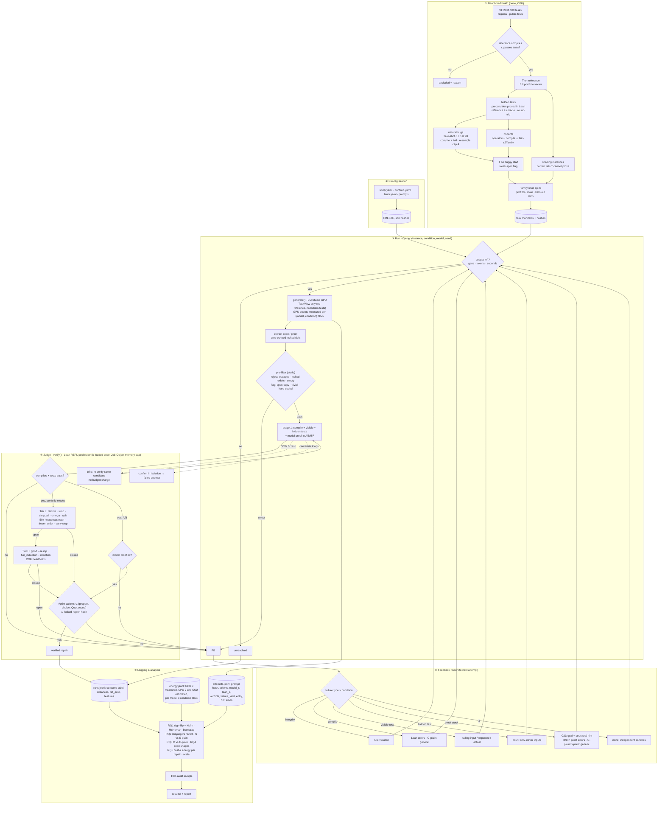

# Final Architecture (v2, consolidated)

**Status:** decided 2026-11-02, before any confirmatory result; **implemented** (see §6). The specification
chain (`requirements.md`, `high_level_design.md`, `low_level_design.md`, `implementation_plan.md`) is updated to
v2 and consistent with this document; `final_proposal.md` is the living summary. All earlier run outputs were
deleted; the study restarts from a clean state.

---

## 1. Which plan are we following?

**The initial proposal's research question, unchanged**, executed with the **GPT verdict's consolidated
experimental framework** as the backbone, plus the two sharpest additions from the **Claude verdict**, the
reporting advice from the **Gemini verdict**, and the engineering additions from **Gracy's notes**.

| Source | What we keep | What we change / drop |
|---|---|---|
| **Proposal** (PDF) | Hypothesis H1 (repair code for a fixed Lean automation suite instead of writing proofs); B vs C as the main comparison; VERINA; local small models; matched budgets; immutable contracts; hidden tests; outcome labels; family-level paired statistics | Qwen2.5-Coder → current Qwen3.5 models (user requirement: latest small models); progressive-hint condition D dropped (replaced by S); "matched compute" made concrete (calls + tokens + inference time) |
| **Plan** (PDF) | Three-member split; two interfaces (`verify`, `generate`); conditions A, B, C, C-plain, T; pre-registration with hashes; pilot gate; backups | Gate 40% → 20% screening (coverage reported on full pool); tactic list frozen as a union |
| **GPT verdict** | Consolidated framework; RQ structure; natural + synthetic bugs reported separately; **proofability study on equivalent implementations** (our study S); withheld *generated* tests; fair budgets; coverage on the full pool | — |
| **Claude verdict** | **B+P baseline** (proof-writer that also gets the portfolio first); **shaping-vs-reverting metric**; T first; floor-effect check | — |
| **Gemini verdict** | Per-category reporting; spec-copying/complexity checks; 10% audit | — |
| **Gracy's notes** | Real model errors first; energy tracking; infra failures don't burn budget; log every attempt with model/Lean time; tiered (light→heavy) tactics; multi-path feedback router; hidden-test privacy; C-plain; spec-gaming pre-filter; 10% audit; resample cap | See §2 for the adaptations |

**Recommended final verdict to agree on (team decision):** *Proceed with the proposal's hypothesis, run under
the GPT verdict's framework, with Claude's B+P baseline and shaping metric as mandatory parts of the main study.*
All three verdicts agree the idea is sound; the GPT verdict is the most complete design, and Claude's two
additions are what make a positive result defensible to reviewers ("C only reverts the mutation" and
"B is a strawman" are the two strongest objections).

---

## 2. Gracy's additions — adopt / adapt / decline

| # | Suggestion | Decision | Reason |
|---|---|---|---|
| G1 | Real (zero-shot) model errors first | **Adopt, as the primary bug source** | Realism; also weakens the "C just reverts a mutant" objection. Mutants stay as a **secondary, controlled** set (per-operator analysis, known fix). Pre-registered fallback: if natural bugs cover < 60 families, the confirmatory pool is natural ∪ mutant (family level). |
| G2 | Energy (codecarbon / pyJoules) | **Adopt, adapted** | GPU energy measured via the NVML energy counter per (model, condition) block (concurrent requests make per-generation attribution ill-defined); Lean CPU energy estimated from worker CPU-seconds × per-thread power and **labelled as an estimate** (Windows has no RAPL; codecarbon would also use a constant-power model there). Reported as Joules per verified repair (RQ5). pyJoules is Linux-only. |
| G3 | 2 GB memory cap via `setrlimit` / `systemd-run` | **Adopt the intent, adapt the mechanism** | Those are Linux-only (we run Windows). A Lean server with Mathlib loaded needs ~1.8–2.7 GB, so 2 GB would kill every check. We use a **Windows Job Object cap of 4 GB per Lean worker**, worker count derived from free RAM, and wall guards. (Phase 0 confirmed the need: workers were killed when another job took 7 GB.) |
| G4 | Infra failures don't burn the budget | **Adopt (already designed), refined** | OOM / crash / server down → the *same* candidate is re-verified, not charged. A timeout caused by the **candidate's own non-terminating code** is the model's fault: confirmed by one isolated re-run, then counted as a failed attempt. (Gracy's diagram treats all timeouts as infra; that would let looping code retry for free.) |
| G5 | Log `model_secs` and `lean_secs` | **Adopt (already done)** | Plus tokens and energy. |
| G6 | Log every attempt to JSONL | **Adopt (already done)** | Attempt records written before the next retry; run records separately. |
| G7 | Adaptive tactic router (light first, heavy fallback) | **Adopt tiering; decline the goal-analyser branch** | Two tiers with **heartbeat** limits (deterministic) instead of 2 s wall-clock (non-deterministic): Tier L (decide/simp/simp_all/omega/split, 50k heartbeats) then Tier H (grind/aesop/induction, 200k). A goal-classifier that *skips* tactics would add an unregistered degree of freedom and can only lower coverage; early stopping already gives the speed. **Applied identically to every portfolio user (T, BP, C, C-plain, S, S-plain)**: applying it to C only (as in one diagram) would confound the comparison. |
| G8 | Multi-path feedback router | **Adopt** | Routes by failure type: integrity / compile / visible-test / hidden-test / proof-stuck / infra. |
| G9 | Hidden-test failures return only a generic status | **Adopt (already done)** | Only a count, never inputs or outputs. |
| G10 | C-plain baseline | **Adopt (already done)** | Gets the same format reminder as C but no information. |
| G11 | AST/regex spec-gaming pre-filter | **Adopt, split into reject vs flag** | *Reject*: sorry/escapes, locked-name redefinitions, empty body. *Flag only* (then mandatory audit): spec-copying, constant/trivial bodies, hard-coded test inputs. The proposal states structural similarity to the spec is not by itself a violation. |
| G12 | 10% manual audit | **Adopt (already designed)** | Stratified by condition. |
| G13 | Resample cap for error generation | **Adopt** | ≤4 samples per generator per family, ≤1 natural bug kept per family per generator. |
| — | Diagram: A/B get "failed, retry" feedback | **Decline** | B must receive Lean errors (proposal; and the verdicts warn against a strawman B). A gets no feedback by definition (independent samples). |

---

## 3. Final conditions

| ID | Model writes | Proof from | Feedback | Bugs | Role |
|---|---|---|---|---|---|
| T | — | portfolio | — | reference + each buggy start | coverage / weak-spec detector |
| A | code + proof | model | none (N independent samples) | natural, mutant | lower bound (pass@N) |
| B | code + proof | model | Lean errors + visible witness | natural, mutant | proposal's control |
| **BP** | code + proof | portfolio first, else model | as B | natural, mutant | isolates "don't write proofs" (Claude) |
| **C** | code only | portfolio | witness + best unsolved goal + structural hint | natural, mutant | **method** |
| C-plain | code only | portfolio | "rejected, try again" + format reminder | natural, mutant | RQ3 ablation |
| S / S-plain | code only | portfolio | goal + hint / plain | correct references T cannot prove | mechanism (GPT §4B) |

Budget per (instance, condition, model, seed): ≤ 8 generations, ≤ 48k tokens, ≤ 240 s inference — first cap wins.

## 4. Final models

| Role | Models |
|---|---|
| Primary repairers | Qwen3.5-2B, Qwen3.5-4B |
| Secondary repairer (other family) | Gemma-4-E4B-it |
| Proof specialist (A, B only) | Goedel-Code-Prover-8B |
| Natural-bug generators (never repairers) | Qwen3.5-0.8B (weak errors), Qwen3.5-9B (subtle errors) |

All GGUF 4-bit, LM Studio with the CUDA engine, `reasoning_effort: none`, fixed decoding and seeds.

---

## 5. Architecture diagram

---

## 6. Implementation of this architecture (done)

| # | Item | Where | Test |
|---|---|---|---|
| 1 | Natural bugs from two generators (0.8B, 9B), resample cap, primary-pool rule (G1, G13) | `prl/natural/collect.py`, `prl/cli.py`, `prl/analysis/report.py: primary_pool` | `test_primary_pool_rule` |
| 2 | Two-tier portfolio with per-tier heartbeats, identical for every portfolio user (G7) | `prereg/portfolio.yaml`, `prl/lean/portfolio.py`, `prl/lean/builder.py` | `test_portfolio_tiers_light_before_heavy` |
| 3 | Energy: NVML GPU energy counter per (model, condition) block; CPU and CO2 estimates (G2) | `prl/energy.py`, `prl/driver/runner.py`, `report.py: energy_table` | `test_energy_block_math` |
| 4 | Windows Job Object 4 GB cap per Lean worker; workers from free RAM (G3) | `prl/lean/runner.py` | verified on the live worker |
| 5 | Failure taxonomy: infra vs candidate timeout/resource (G4) | `prl/lean/verify.py: classify_failure`, `prl/conditions/protocols.py: verify_with_infra_retry` | `test_failure_classification` |
| 6 | Feedback router with all failure paths (G8, G9) | `prl/conditions/feedback.py` | `test_feedback_router_paths` |
| 7 | Pre-filter split into reject vs flag; flagged successes always audited (G11, G12) | `prl/lean/integrity.py`, `report.py: audit_sample / audit_merge` | `test_degeneracy_flags` |
| 8 | Documentation updated to v2 | `docs/` | coherence check |

Note: codecarbon was not used for the CPU estimate: on Windows it also falls back to a constant-power model, so
an explicit, documented estimate (`prereg/study.yaml: energy`) is more transparent. GPU energy is measured.
