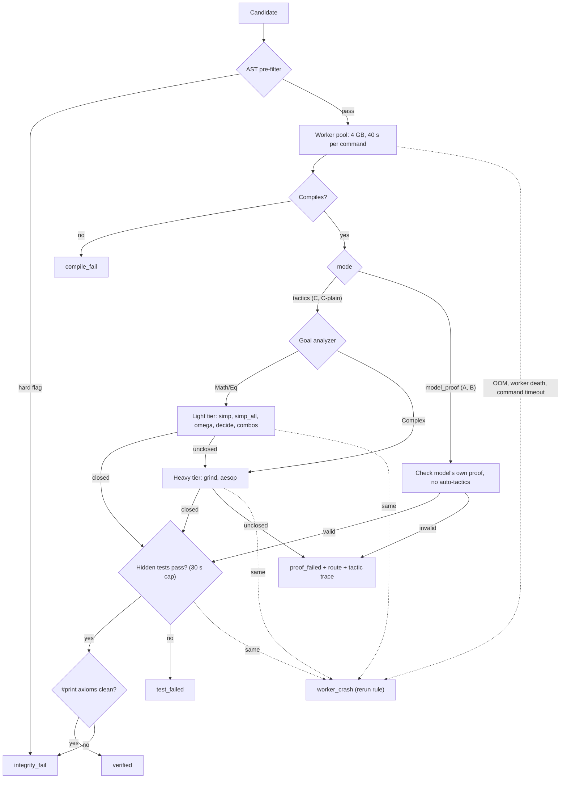

# Phase 4 — Verifier engine and test runner

[← index](../ARCHITECTURE.md) · **Member A**

`verify(task, code, proof=None, mode)` is deterministic, cached, and runs all Lean work through the worker pool.

## 1. Pipeline



After the proof passes, the integrity layer runs `#print axioms` on the theorem and rejects `sorryAx`, new axioms, `native_decide`, `implemented_by`, `unsafe`. Spec and test files are re-hashed against the manifest.

## 2. AST pre-filter (spec-gaming)

Runs before any Lean work, so cheating costs no Lean time and no energy. Applies to all conditions — code region always, proof region too in A and B.

Python's `ast` cannot parse Lean, so this is a tokenizer plus regex over the implementation region, optionally with a tree-sitter Lean grammar for the structural rules. Same code path for every condition.

| Rule | Class | Action |
|---|---|---|
| Forbidden tokens: `sorry`, `admit`, `axiom`, `native_decide`, `implemented_by`, `unsafe`, `extern` | hard | `integrity_fail` |
| Edit outside the allowed implementation region (region diff) | hard | `integrity_fail` |
| Empty or placeholder body (`sorry`, `default`, `arbitrary`, unconditional `[]`, `0`, `true`, `none` where the spec is non-trivial) | hard | `integrity_fail` |
| Constant output: body is only literals and mentions no parameter | hard | `integrity_fail` |
| Tautology or vacuous shortcut (`if True`, `decide True`, always-satisfied branch) | hard | `integrity_fail` |
| Spec copying: body is Prop-valued or non-computable, contains the postcondition's quantifiers, or token overlap with the postcondition ≥ 0.80 | hard | `integrity_fail` |
| Proof text in the code region in C / C-plain (`theorem`, `lemma`, `example`) | hard | `integrity_fail` |
| Spec overlap 0.60–0.80; body under 30% of the buggy code's size; `decreasing_by` or `termination_by` | warn | pass, always hand-audited |

Structural similarity to the spec alone is not a violation if the implementation is executable and legitimate — only the 0.80 / quantifier / non-computable cases are hard.

> **Note.** `grind` and `aesop` in B's proof region are **not** flagged. See [driver-and-analysis.md](driver-and-analysis.md#cross-evaluation-bs-code-through-cs-pipeline).

## 3. Sandbox and the persistent Lean worker

**Why changed.** Revision 2 used one short-lived process per stage, so each candidate paid `import Mathlib` four times. That import is 15–25 s on the Fedora target, which blew the old 30 s process cap: Lean died during import and every C attempt was misrecorded as a model failure. Revision 3 pays it once per worker.

**Design.** `lean_workers = 2` persistent REPL processes (`leanprover-community/repl`), started per batch, importing only `worker.imports` — **never bare `import Mathlib`**. `verifier/sandbox.py` owns the pool.

**Three budgets, all required:**

| Layer | Mechanism | Value | Catches |
|---|---|---|---|
| Tactic | `set_option maxHeartbeats ... in` per rung | ≈ 2 s light, ≈ 8 s heavy | the reported, deterministic budget |
| Command | worker-side timer | `cmd_wall_secs = 40` | elaboration heartbeats do not count |
| Process | OS kill of the worker | `proc_wall_secs = 60` | runaway externals, wedged worker |

`maxHeartbeats` does **not** bypass import — import sits outside the `set_option` scope and is simply uncounted, so the process cap must still clear it: `proc_wall_secs ≥ import + tier budget + margin`. `maxHeartbeats 0` is unlimited; calibration must never emit it.

**Memory.** 4 GB per worker by cgroup (`systemd-run --user --scope -p MemoryMax=4G -p MemorySwapMax=0`), up from 2 GB because a worker holds Mathlib resident for its lifetime. `RLIMIT_AS` is **removed** — it caps virtual memory and Lean mmaps `.olean`, so it is now a guaranteed failure, not defence in depth. Blocking Week 1 check, else `MemoryMax` is silently ignored:

```
cat /sys/fs/cgroup/user.slice/user-$(id -u).slice/cgroup.controllers   # must contain `memory`
```

**Restart** on any of: 50 candidates, RSS over 3584 MB, failed health probe, command timeout, process death. A fresh worker passes `health_probe` before taking work. Restart costs one import, so prefer it when in doubt.

**Classification.** Heartbeat exhaustion is a normal `proof_failed` (consumes N). `cmd_wall_secs` firing or worker death is `worker_crash`: requeue to a fresh worker, same `attempt_idx`, no N consumed. Same signature twice on one candidate → `resource_exhausted`, consumes N — the revision 2 reproduction rule, so expensive code still cannot buy free attempts. cgroup `oom_kill` and `proc_wall_secs` follow the same rule.

**Fallback.** If the REPL is unstable, revert to one-shot processes with targeted imports and a raised `proc_wall_secs`, then recompute the load estimate in [config.md](config.md) before the freeze.

## 4. Adaptive tactic router (C and C-plain only)

```
route = goal_analyzer(first_unsolved_goal)      # rule-based, no LLM
if route == "Math/Eq":   run light tier;  if unclosed -> run heavy tier
if route == "Complex":   run heavy tier directly
```

- **Light tier** (2 s per tactic, ≤ 14 s): `simp`, `simp_all`, `omega`, `decide`, `unfold; simp`, `unfold; omega`, `split; simp_all`.
- **Heavy tier** (8 s per tactic, ≤ 16 s): `grind` (Lean 4.24+), `aesop`.
- Each tier is one command with one independent `theorem` per rung and a per-rung `set_option maxHeartbeats ... in`. The first closing rung in the registered order is the `closing_tactic`. Heartbeats are deterministic; wall clock is not.
- A tactic that fails or exhausts its budget is a **normal `proof_failed`**, recorded in the tactic trace. Not infrastructure. Consumes N.
- **Coverage guard:** routing changes order and cost, not the toolset. On the 20 pilot references the router must close at least what the full ladder closes; otherwise widen the "Complex → heavy only" rule before the freeze.
- List, order and budgets are tuned on pilot tasks only, then frozen with a hash. Any later change is a reported deviation.
- A and B never use this pipeline — their proof is checked as written (`model_proof`, no auto-tactics).

## 5. Hidden tests

Run by `tests_runner.py` (`#eval` or compiled executable), 30 s cap, same worker pool. Must agree with VERINA's own results on every reference. Test timeouts that reproduce on rerun are `test_failed`. Test inputs and expected outputs never leave `verify()`; only the boolean and a generic warning reach the feedback path.

## 6. Caching and determinism

Cache key: `sha256(task_id, code, proof, mode, tactics_hash, params_hash)`.

- `infra_crash` and `worker_crash` results are never cached.
- Results that hit `cmd_wall_secs` or `proc_wall_secs` are **never cached** — those limits are load-dependent and would otherwise pin a wrong verdict to a candidate hash forever. Only heartbeat-bounded outcomes are cacheable. (Closes a revision 2 hole.)
- Worker state must not leak between candidates: one command per candidate with its own `theorem` names; restart on protocol desync.
- Same input gives the same output across reruns, checked with 1,000 unattended calls **spanning a worker restart**.
